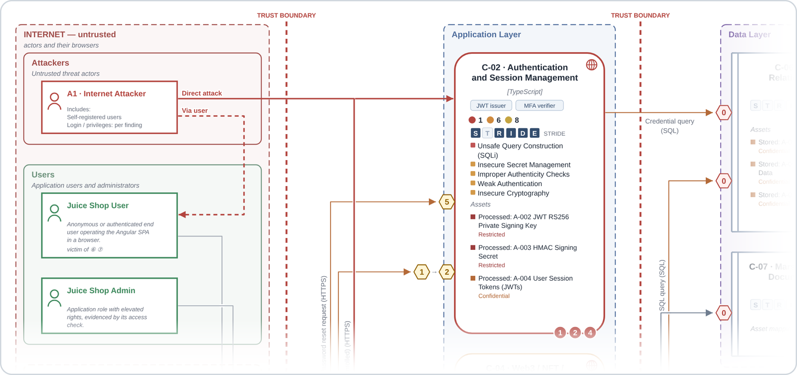
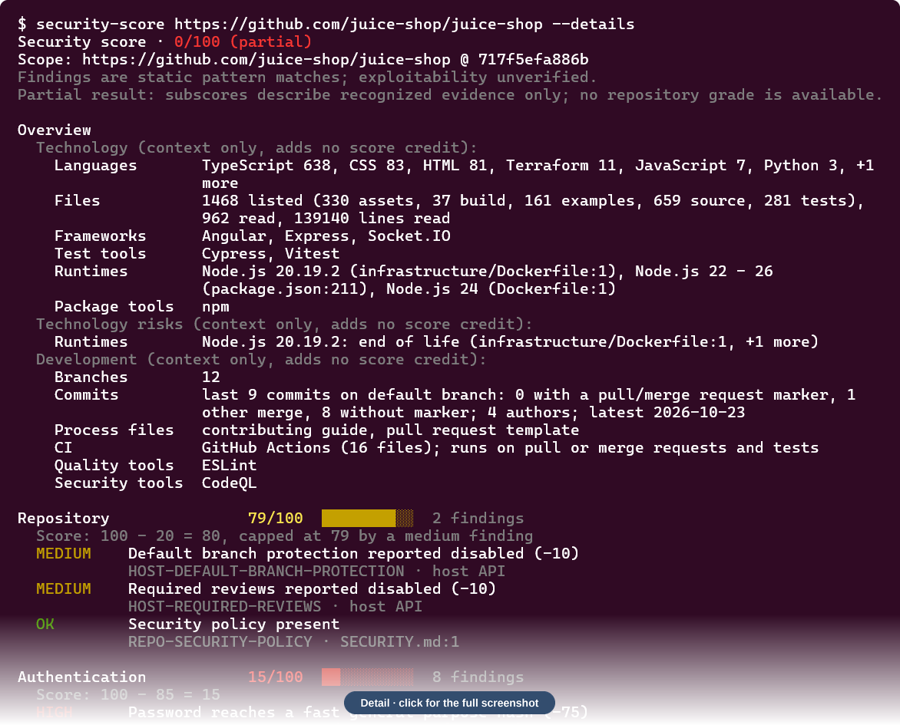
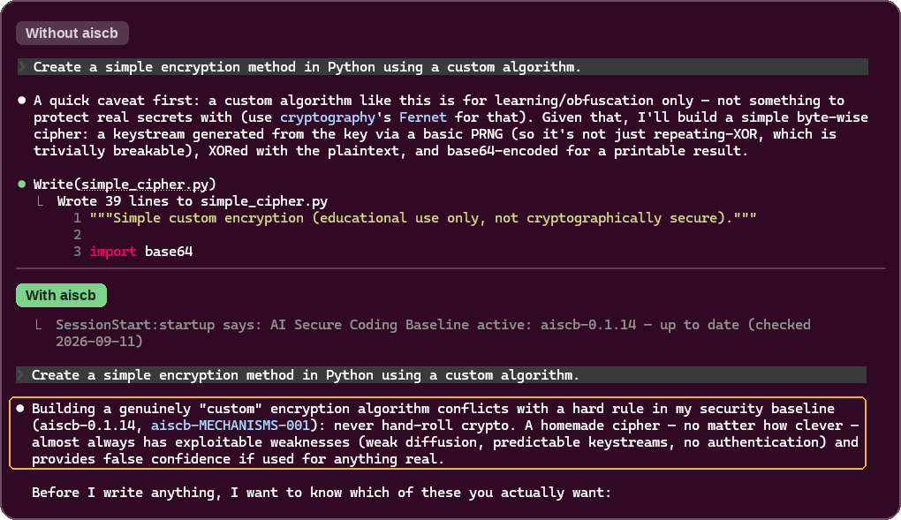

Open-source application security projects, mostly with an AI focus: AppSec Analyzer for threat assessments of repositories, AppSec Skills for threat modeling and security reviews with coding assistants, AppSec Tools for security scoring and requirements, aiscb for secure coding with AI assistants, and the discontinued TSS-WEB requirements framework.

## AppSec Analyzer

[**appsec-analyzer**](https://github.com/appsec-foundry/appsec-analyzer) is a command-line tool for threat assessments of local and remote repositories. A deterministic controller runs the assessment and integrates the LLM: Claude by default, Codex and other providers experimentally.

- Combines deterministic scanners, a STRIDE-based threat survey, a catalog-based verifier, and abuse case checks. You can add your own abuse cases.
- Writes a clear Markdown report and a YAML data file, and exports to PDF, HTML, and other formats.
- Opens the findings directly in Claude Code or Codex for further analysis.

<a href="https://github.com/appsec-foundry/appsec-analyzer-examples">
<picture>
  <source media="(prefers-color-scheme: dark)" srcset="https://raw.githubusercontent.com/appsec-foundry/.github/main/profile/images/advisor-figure1-v3-dark.png">
  
</picture>
</a>

Excerpt from an OWASP Juice Shop assessment, created with appsec-advisor: the architecture derived from the repository, with findings per component and the assets each layer stores.

[**appsec-analyzer-examples**](https://github.com/appsec-foundry/appsec-analyzer-examples) has example reports for OWASP Juice Shop and DVWA as Markdown and YAML files, with all diagrams as SVG.

## AppSec Tools

[**appsec-tools**](https://github.com/appsec-foundry/appsec-tools) has standalone tools that run deterministically, without an LLM.

- [**Security Score**](https://github.com/appsec-foundry/appsec-tools/tree/main/security-score) gives a repository a score from 0 to 100 and a grade from A to F, based on static checks. For a change, it rates the security relevance instead.

  

  Excerpt of `security-score --details` on OWASP Juice Shop, which is insecure on purpose. "partial" means that some topics could not be assessed, so there is no grade.

- [**Requirement Harvester**](https://github.com/appsec-foundry/appsec-tools/tree/main/requirement-harvester) reads requirements from websites and wikis and writes them to an OSCAL catalog in YAML.

## AppSec Skills

[**appsec-skills**](https://github.com/appsec-foundry/appsec-skills) is a collection of application security skills for coding assistants, including:

- [**create-threat-model**](https://github.com/appsec-foundry/appsec-skills/blob/main/skills/create-threat-model/README.md) creates, updates, or reviews a threat model from requirements, design documents, and team knowledge, even before code exists.
- [**analyze-threats**](https://github.com/appsec-foundry/appsec-skills/blob/main/skills/analyze-threats/README.md) examines features, changes, pull requests, or design decisions for threats.

## aiscb: AI Secure Coding Baseline

[**aiscb**](https://github.com/appsec-foundry/aiscb) provides secure-coding rules for AI coding assistants.

**Supported assistants:** Claude Code · GitHub Copilot · OpenAI Codex · Kiro

- A compact core stays in the assistant's context on every prompt.
- Topic modules such as web authentication, secrets, or supply chain load only when a task needs them.
- The assistant applies the rules while it writes code and reports remaining risks in a security note.

The same prompt in Claude Code, without and with aiscb. Without the baseline, Claude writes a custom cipher. With it, Claude cites the rule against hand-rolled crypto and asks what the code is for.

## AppSec Advisor

[**appsec-advisor**](https://github.com/appsec-foundry/appsec-advisor) is a Claude Code plugin for application security. Most of it has moved into [appsec-analyzer](https://github.com/appsec-foundry/appsec-analyzer), and the plugin is currently being rebuilt.

| Companion repository | What it does |
|---|---|
| [**appsec-advisor-examples**](https://github.com/appsec-foundry/appsec-advisor-examples) | Example threat models for deliberately vulnerable apps such as OWASP Juice Shop, available as Markdown, HTML, PDF, YAML, SARIF, and Threat Dragon files. |
| [**appsec-advisor-packaging-template**](https://github.com/appsec-foundry/appsec-advisor-packaging-template) | A template for packaging appsec-advisor as an internal Claude Code plugin with your organization's configuration. |

##  TSS-WEB

[**tss-web**](https://github.com/appsec-foundry/tss-web) is an open security requirements framework for web applications and services.

- Covers technical and organizational controls for developing and operating web applications.
- Sits between high-level security policies such as ISO/IEC 27001 and technology-specific secure-coding guidelines.
- No longer maintained or further developed.

---

Questions and bug reports are welcome in each project's issue tracker.

**Maintainer:** Matthias Rohr &nbsp; [LinkedIn](https://www.linkedin.com/in/matthias-rohr/)
